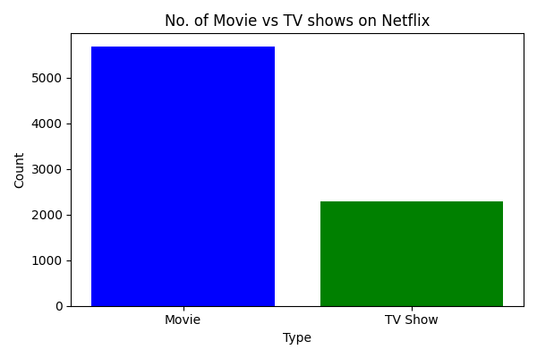
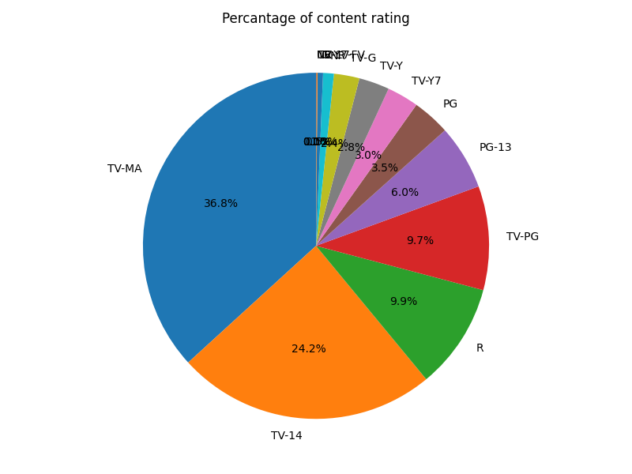
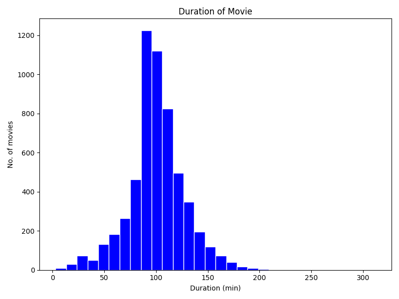
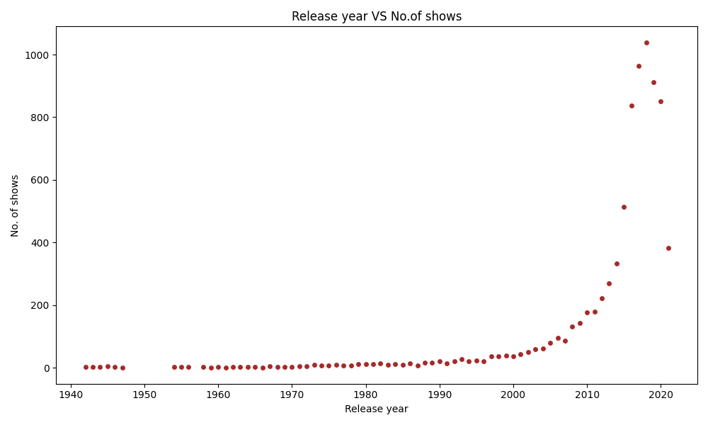
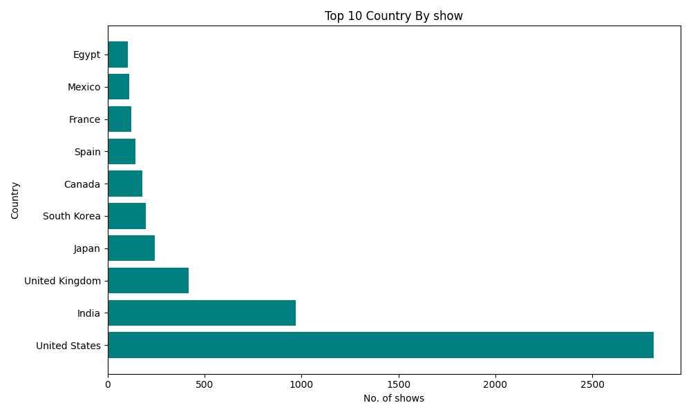
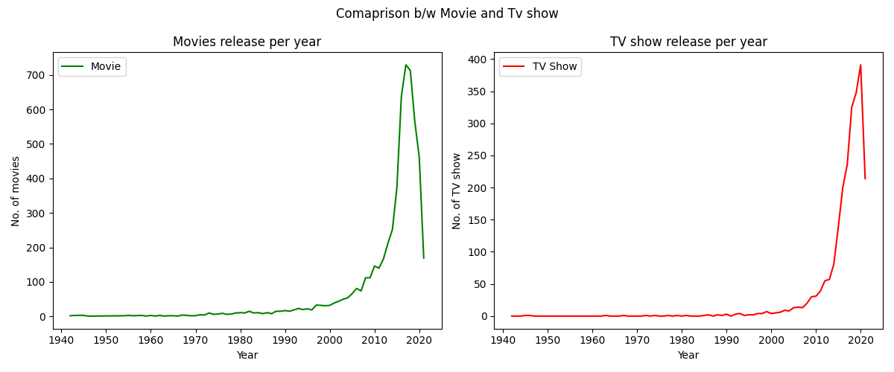

# Netflix Data Visualization Project

## Project Overview
This project focuses on analyzing and visualizing Netflix content data using Python. The main objective is to explore the Netflix dataset and understand different patterns and trends through graphical representations.

## Tools & Technologies
- Python
- Pandas
- Matplotlib
- Jupyter Notebook

## Data Analysis & Visualizations

The following visualizations are created in this project:

1. Movies vs TV Shows – Comparison of Movies and TV Shows available on Netflix.
2. Content Rating Distribution – Pie chart showing the distribution of content ratings.
3. Movie Duration Analysis – Histogram showing the distribution of movie durations.
4. Release Year Analysis – Scatter plot showing the number of titles released in different years.
5. Top 10 Countries – Horizontal bar chart showing the top 10 countries by content count.
6. Movies vs TV Shows by Year – Line charts comparing yearly releases of Movies and TV Shows.

## Project Visualizations

### 1. Movies vs TV Shows

### 2. Content Rating Distribution

### 3. Movie Duration

### 4. Release Year Analysis

### 5. Top 10 Countries

### 6. Movies vs TV Shows by Year

## Project Structure

- `Netflix_Analysis.ipynb` – Complete Python analysis and visualization code.
- `netflix_dataset.xlsx` – Dataset used for analysis.
- `images/` – Output images of all visualizations.

## How to Run the Project

1. Clone or download this repository.
2. Install the required libraries:

   `pip install pandas matplotlib openpyxl jupyter`

3. Open the Jupyter Notebook.
4. Run the cells to generate the visualizations.

## Conclusion

This project helped me understand data analysis and visualization using Python. It provided practical experience in data manipulation, grouping, filtering, and creating different types of charts.
